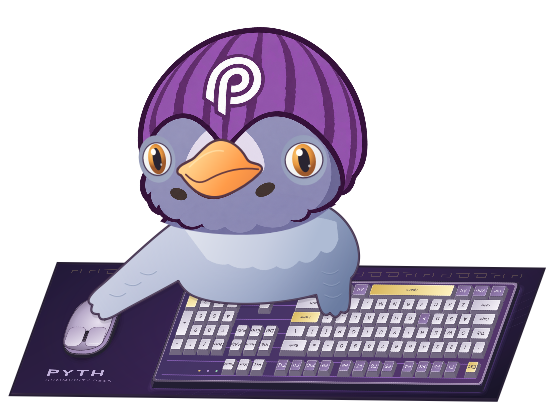
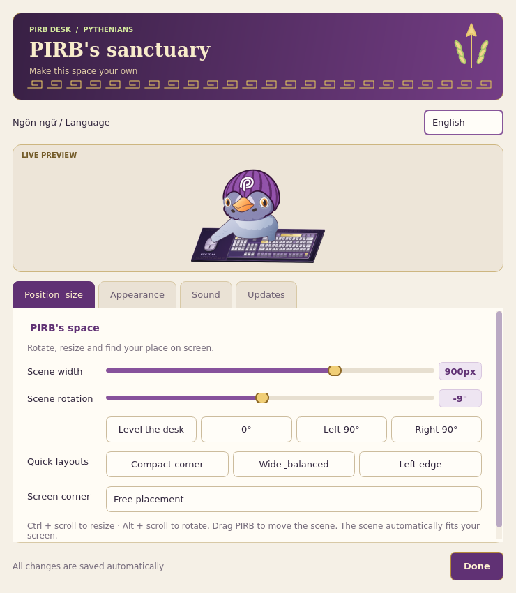

# Pirb Desk 0.10.3

Previously **PIRB Studio**. Community desktop companion; not an official Pyth product. The repository URL and stable preference/data IDs stay unchanged for upgrades.



## 0.10.3 — Clean lower border

Draw the matte outer desk directly at final screen resolution, without a thin bright stroke or a second resampling of its edge. Remove the extra low-contrast texture outline and tiny front Greek ornament that broke into dashes when reduced. Keep texture, RGB and keyboard shadows inside an adaptive inset; add a small front clearance below the keyboard. Each new key state is rebuilt from the bare keyboard case before projection and cached, preventing raised idle-key remnants across raster backends. Rebuild caches when monitor DPI changes.

Regression checks cover all four visible pixel boundaries at 100/125/150/200% DPI, key-held states against a full redraw and DPI cache changes. These are render tests, not a claim that every Windows desktop/compositor has been manually tested.

## Four-corner desk outline (since 0.10.2)

The complete desk silhouette is now a single parallelogram: four corners, with **both** pairs of opposite edges parallel. The front bevel and border are painted inside this shape; there is no extruded six-corner body outside it. Keyboard RGB is clipped to the same shape. This supersedes 0.10.1, which only thinned the extruded body.


## Features introduced in 0.10.0

The tabletop, texture and keyboard now share one projection, with a thin desk fascia. New profiles use a quiet purple **Pyth Classic** surface. Existing profiles keep their selected images; choose **Appearance → Use Pyth Classic background** to switch.

**Sound → Choose WAV…** imports your own regular-key, Space, Enter, Backspace, modifier and mouse sounds. Supported input: mono/stereo PCM WAV, up to 3 seconds and under 8 MB. Files are copied into stable app data. Unassigned keyboard categories fall back to your regular-key override, then Thock; an unassigned mouse uses Thock. Test, clear individual overrides, or restore Thock. Direct MP3/OGG import is not included. Vivid effects add restrained golden motes using Qt, without Three.js/WebEngine.

## Upgrading and compatibility

Download **Pirb_Desk_0.10.3_Windows_x64_Setup.exe**. Exit the old app, install, then use the **Pirb Desk** shortcut. Language, images, pose and volume are retained. Setup removes the old named shortcut only when it targets the app-owned installed PIRB.exe. Old version folders are retained.

The release also includes **PIRB_Studio_0.10.3_Windows_x64_Setup.exe**, a byte-identical installer alias for installed 0.9.x update clients. Download only one Setup. Both names are listed in SHA256SUMS.txt. New clients accept the new and legacy asset names. The stable install parent and uninstall registry key keep their old internal IDs deliberately.


[Tiếng Việt](README_VI.md) · **Version 0.10.3** · Windows x64

An animated pigeon desktop companion that reacts to typing and mouse clicks. Customize the scene, expressions, effects and sounds in a Pythenians-inspired purple, gold and ivory Settings window.



## Install

Download **Pirb_Desk_0.10.3_Windows_x64_Setup.exe** from the repository's **Releases**. GitHub's **Code → Download ZIP** downloads source code, not the ready-to-run app.

1. Exit old PIRB using its system-tray menu.
2. Run Setup and confirm the installation.
3. Open **Pirb Desk** from Desktop or Start Menu.

Python, Qt, artwork, sounds and both Settings languages are bundled. No Python, pip, WinRAR or administrator rights are needed. Setup and the companion work offline after downloading; optional update checks need internet. No separate Settings patch is needed.

Install location: `%LOCALAPPDATA%\Programs\PIRBStudio\0.10.3\PirbDesk`.

Portable alternative: extract the **entire** `Pirb_Desk_0.10.3_Windows_x64_Portable.zip`, then run `PirbDesk\PirbDesk.exe`. Keep `_internal` beside the executable. Do not run inside an archive viewer. Portable also stores preferences in your Windows user profile.

## Requirements

| Item | Requirement |
| --- | --- |
| OS | Windows 10 version 1809 or later, or Windows 11; Intel/AMD **64-bit x64** |
| Storage | Reserve **300 MB free** for the app and installation temporary files |
| Display | A normal desktop session; 1280 × 720 or larger recommended for Settings |
| Input | Keyboard and mouse; global input drives the animation |
| Audio | An enabled audio output, only if sounds are wanted |
| Other | Windows built-in `tar.exe` for Setup, present in standard supported Windows installations |
| Internet | Needed to download and check updates; companion animation works offline |

32-bit Windows and native Windows ARM64 are not supported. Linux/macOS can render a source demo only. 300 MB is an installation allowance, not a measured RAM requirement.

References: [Qt 6.8 Windows support](https://doc.qt.io/qt-6.8/windows.html), [Windows tar](https://learn.microsoft.com/en-us/windows/tar), [Python embedded runtime](https://docs.python.org/3.12/using/windows.html#the-embeddable-package).

## Use

Right-click PIRB or its tray icon → **Giao diện & âm thanh… / Appearance & sound…**.

- **Language:** choose **English** or **Tiếng Việt** at the top of Settings. Text and the context menu change immediately; the choice persists after restart. First launch defaults to Vietnamese.
- **Position & size:** rotate the whole scene −180° to +180°, set a base width of 180–1200 px, select a screen corner or a quick layout. **Level the desk** compensates for the artwork's diagonal desk angle.
- **Appearance:** choose/import a background (PNG/JPG/WEBP under 30 MB), adjust crop/brightness/orientation, pose PIRB, choose expressions, keyboard lights and effects.
- **Sound:** Thock/Clicky/Tactile; keyboard, mouse and idle coo switches; individual volumes and preview buttons.
- **Ctrl + wheel** over PIRB resizes; **Alt + wheel** rotates. Left-drag moves the whole scene.
- Context menu: pause, lock, click-through, show/hide or exit. If click-through is enabled, open Settings from the tray icon.

Changes save automatically. Only one instance runs at a time. Startup with Windows is not enabled automatically; optionally copy the Desktop shortcut into the folder opened by **Win + R → `shell:startup`**.

## Updates

From **PIRB Studio 0.9.1**, PIRB checks public GitHub Releases a few seconds after startup and every **6 hours** while running. Checks are throttled across restarts. If a newer complete Windows release is available, it asks **Update now / Later**, with release notes. Choosing Later leaves the app unchanged; the same version is not prompted again in that session. Manual checks can show it again.

In **Settings → Updates**, turn automatic checks on/off, include/exclude pre-releases, or press **Check for updates now**. Pre-releases are included by default while this project is in its 0.x preview stage. Drafts, incomplete releases, equal/older versions and mismatched asset URLs are ignored. Automatic failures stay quiet; manual failures show a message.

After you choose Update now, the app downloads only this repository's Windows x64 Setup, shows progress/Cancel, verifies the size, SHA256SUMS and GitHub asset digest when present, opens Setup and exits PIRB. Finish the normal Setup confirmation; preferences are retained. Corrupt/incomplete downloads never launch. Checksums verify transfer integrity; the community installer is still unsigned. A cancelled update leaves the current version unchanged.

**Users of 0.8.1 and earlier must manually install 0.10.0 once.** Those old versions cannot acquire the update feature themselves. No GitHub account/token or separate Python installation is needed. The app never installs without the user's update choice.

## Upgrade, uninstall and troubleshooting

Exit the old app before upgrading. Existing preferences are reused. Old version folders/downloads are preserved, not automatically deleted.

For an installed copy, exit PIRB and use **Windows Settings → Apps → Pirb Desk 0.10.3 → Uninstall**, or run its `Uninstall.exe`. Preferences/custom images remain. For portable, exit and delete its extracted folder; the included uninstaller targets the installed location only.

If startup fails, run `_internal\support\DIAGNOSTICS.bat`. Errors may be written to `%LOCALAPPDATA%\PIRBDesktop\startup-error.log`. For sound issues check Windows output/Volume Mixer and the Sound tab. If another app's keys do not animate, test with a normal non-elevated app. Report the exact message, PIRB version and Windows version. The community build is unsigned and Windows may warn about its publisher; the app does not require disabling protection.

Preferences use `QSettings('PIRBCompanion', 'Desktop')`, normally `HKEY_CURRENT_USER\Software\PIRBCompanion\Desktop`. Imported images are copied to Qt's per-user `AppDataLocation` for `PIRBCommunity/PIRBDesktop`. Key states exist transiently in memory for animation; typed text is not recorded, input/images/custom sounds are not sent online, and there is no telemetry. Optional update checks read public GitHub Releases over HTTPS.

## Develop and build

For development install **Python 3.12 x64**:

```powershell
python -m venv .venv
.venv\Scripts\python -m pip install -r requirements.txt
.venv\Scripts\python app\main.py
```

Linux/macOS visual demo: `python app/main.py --demo`.

Build complete Windows distributions:

```powershell
.venv\Scripts\python -m pip install -r requirements-build.txt
.venv\Scripts\python -m unittest discover -s tests -v
.venv\Scripts\python tools\build_windows.py
```

The same tool cross-compiles on Linux. It downloads checksum-pinned official Windows CPython 3.12.10 and PySide6/Qt 6.8.3, resolves native dependencies and builds launcher/installer/uninstaller with Zig 0.13.0. Outputs: Setup, portable ZIP and `SHA256SUMS.txt` in `dist/`. `--cache PATH` reuses verified inputs. Build downloads require network; the installed app does not. See [release procedure](docs/RELEASING.md).

GitHub Actions tests source on Linux, builds on Windows and smoke-tests portable startup. A successful main-branch build publishes a new version as a pre-release when that version has no published assets; matching tags are also supported. Published assets are preserved, so bump VERSION for the next update. See [validation status](docs/VALIDATION.md); a committed workflow is not evidence that it has run.

## Version and credits

[CHANGELOG](CHANGELOG.md) · [LICENSE](LICENSE) · [Third-party notices](THIRD_PARTY_NOTICES.md) · [Asset credits](app/ASSET_CREDITS.md)

This is a community project, not an official Pyth product. No open-source license has been selected for the original app code; third-party components retain their own licenses. Bongo Cat inspired the camera angle; no Bongo Cat code or textures are included.
