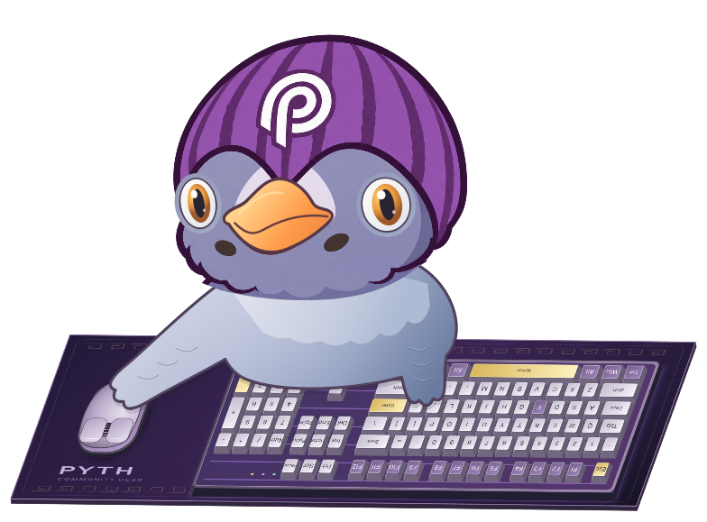
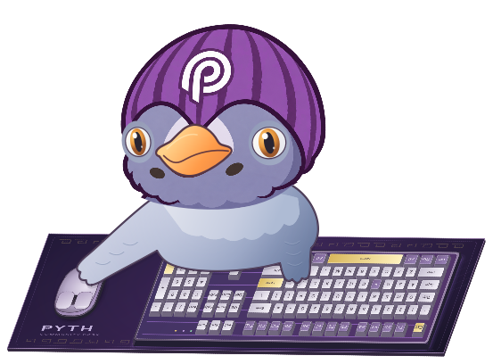

# Pirb Desk 0.10.1

[English](README.md) · Chim bồ câu phản hồi bàn phím và chuột trên Windows.

**Tên mới của PIRB Studio.** Giữ nguyên repo và vùng lưu dữ liệu để không mất ngôn ngữ, tư thế, ảnh riêng và âm lượng khi nâng cấp. Đây là app cộng đồng, không phải sản phẩm Pyth chính thức.

### Sửa góc bàn trong 0.10.1

Dựng cạnh bàn thành một khối liền và mỏng hơn, thống nhất màu/viền, bỏ dải cạnh phải tối và nét chồng ở góc trước. Hai cạnh mặt trên vẫn giữ chung hướng hình học; không đổi vị trí bàn phím hay điểm chạm cánh.

### Các tính năng từ 0.10.0

- Mặt bàn và bàn phím dùng chung hệ phối cảnh; cạnh bàn có chiều dày, không còn nghiêng so le.
- **Pyth Classic** tím là nền mặc định cho hồ sơ mới. Hồ sơ cũ giữ nền đã chọn; vào Giao diện → **Dùng nền Pyth Classic** để chuyển.
- Âm thanh → chọn loại phím/chuột → **Chọn WAV…** để dùng âm của bạn. Hỗ trợ WAV PCM mono/stereo, tối đa 3 giây và dưới 8 MB; file được chép vào dữ liệu app. Chọn một âm phím thường để dùng chung, rồi ghi đè Space/Enter/Backspace/phím bổ trợ nếu muốn. Chuột chưa gán dùng Thock.
- Có nghe thử, bỏ từng âm riêng và khôi phục Thock. Âm riêng được giữ khi đổi ngôn ngữ, khởi động lại hoặc nâng cấp. Bản này chưa nhập MP3/OGG trực tiếp.
- Hiệu ứng Rực rỡ có thêm vòng sáng và tia vàng nhẹ, vẫn dùng Qt; không thêm Three.js/WebEngine.

## Cần gì để sử dụng?

| Thành phần | Yêu cầu |
| --- | --- |
| Hệ điều hành | Windows 10 từ bản 1809 trở lên hoặc Windows 11, **64-bit x64 Intel/AMD** |
| Dung lượng | Chừa **300 MB trống** cho ứng dụng và tệp tạm lúc cài |
| Màn hình | Phiên desktop Windows; khuyến nghị từ 1280 × 720 để dùng Settings thoải mái |
| Thiết bị | Bàn phím, chuột; loa/tai nghe chỉ cần nếu muốn có âm thanh |
| Phần mềm thêm | **Không cần Python, pip, WinRAR hay công cụ lập trình** |
| Internet | Cần để tải/kiểm tra cập nhật; hoạt ảnh vẫn chạy ngoại tuyến |

Đã kèm Python 3.12.10, PySide6/Qt 6.8.3, ảnh, âm thanh, Settings Pythenians và hai ngôn ngữ. Setup dùng `tar.exe` có sẵn trên Windows tiêu chuẩn. Không hỗ trợ Windows 32-bit, native ARM64 hoặc chạy desktop thật trên macOS/Linux. 300 MB là khoảng dự phòng cài đặt, không phải RAM tối thiểu đã đo.

## Cài đặt

1. Vào **Releases**, tải **Pirb_Desk_0.10.1_Windows_x64_Setup.exe**. **Code → Download ZIP** chỉ là mã nguồn, không phải bộ cài.
2. Thoát hẳn PIRB bằng menu biểu tượng cạnh đồng hồ.
3. Mở Setup, đồng ý cài cho tài khoản hiện tại.
4. Mở **Pirb Desk** từ Desktop hoặc Start Menu.

Không cần quyền quản trị hay tệp cập nhật Settings riêng. Thư mục cài: `%LOCALAPPDATA%\Programs\PIRBStudio\0.10.1\PirbDesk`.

Bản portable: giải nén **toàn bộ** `Pirb_Desk_0.10.1_Windows_x64_Portable.zip`, mở `PirbDesk\PirbDesk.exe`, giữ `_internal` bên cạnh. Không mở trực tiếp trong WinRAR. Portable vẫn lưu tùy chọn vào hồ sơ Windows.

## Cách sử dụng

Nhấp phải PIRB hoặc biểu tượng cạnh đồng hồ → **Giao diện & âm thanh…**.

- **Ngôn ngữ / Language:** ở đầu Settings, chọn **Tiếng Việt / English**. Áp dụng ngay cho Settings và menu chuột phải, được lưu cho lần mở sau.
- **Vị trí & kích thước:** xoay cả cảnh −180° đến +180°, chiều rộng cơ sở 180–1200 px, bám góc hoặc chọn bố cục nhanh. **Canh bàn ngang** bù góc nghiêng của hình bàn.
- **Giao diện:** chọn nền/nhập ảnh PNG/JPG/WEBP dưới 30 MB; xoay/phóng/dịch/chỉnh sáng ảnh; chỉnh tư thế, biểu cảm, RGB và hiệu ứng.
- **Âm thanh:** Thock/Clicky/Tactile; bật tiếng phím, chuột, gù; chỉnh âm lượng riêng và nghe thử.
- **Ctrl + cuộn:** thu/phóng; **Alt + cuộn:** xoay; giữ chuột trái kéo để di chuyển cả cảnh.
- Menu có tạm dừng, khóa vị trí, bấm xuyên, hiện/ẩn và thoát. Nếu đã bật bấm xuyên, mở Settings qua biểu tượng cạnh đồng hồ.

Mọi thay đổi lưu tự động. Chỉ chạy một phiên PIRB. Không tự khởi động cùng Windows; nếu muốn, chép shortcut Desktop vào thư mục mở bằng **Win + R → `shell:startup`**.

## Đổi tên và nâng cấp từ PIRB Studio

Tải bộ cài **Pirb_Desk_0.10.1_Windows_x64_Setup.exe**, thoát app cũ rồi cài. Shortcut mới tên **Pirb Desk**; Setup chỉ gỡ shortcut PIRB Studio cũ nếu nó trỏ đúng bản cài do app sở hữu. Không xóa các thư mục phiên bản cũ hoặc dữ liệu riêng.

Bản phát hành cũng có **PIRB_Studio_0.10.1_Windows_x64_Setup.exe**: đây là bản sao cùng nội dung/checksum, chỉ để updater 0.9.x nhận được tên tệp quen thuộc. Cả hai cài cùng Pirb Desk, chỉ cần tải một file. Giữ repo `liemdak/pirb-studio`, registry/QSettings/app-data ID cũ là chủ ý tương thích, không phải đổi tên còn sót.

## Tự nhận biết bản cập nhật

Từ **PIRB Studio 0.9.1**, app kiểm tra GitHub Releases sau khi mở và mỗi **6 giờ** khi đang chạy, có giới hạn tần suất qua các lần khởi động. Khi có bản mới hoàn chỉnh, app hỏi **Cập nhật ngay / Để sau** và cho xem nội dung thay đổi. Chọn Để sau giữ nguyên ứng dụng; cùng một phiên bản không bị hỏi lại trong phiên chạy đó. Bấm kiểm tra thủ công có thể hiện lại lời mời.

Vào **Settings → Cập nhật** để bật/tắt kiểm tra, chọn nhận bản thử nghiệm hoặc bấm **Kiểm tra cập nhật ngay**. Bản thử nghiệm mặc định được nhận trong giai đoạn 0.x hiện tại. App bỏ qua bản nháp, bản thiếu bộ cài/checksum, bản bằng/cũ hơn và đường dẫn không thuộc repo.

Chỉ khi đồng ý, app mới tải bộ cài x64, hiện tiến trình/nút Hủy, kiểm tra kích thước và SHA256, rồi mở Setup và thoát PIRB. Bạn xác nhận cài như bình thường; tùy chỉnh được giữ lại. Tải lỗi, tệp sai hoặc hủy tải không thay bản đang dùng. Kiểm tra tự động khi mất mạng không bật thông báo lỗi làm phiền.

**Bản 0.8.1 trở về trước cần tải và cài Pirb Desk thủ công một lần.** Từ đó mới có tính năng tự nhận bản mới. Không cần tài khoản/token GitHub, không cần tải Python. Bộ cài đã kèm Python riêng cho PIRB, không phụ thuộc Python trên máy.

Ứng dụng chỉ đọc thông tin phát hành công khai từ GitHub; không gửi nội dung gõ hay ảnh riêng khi kiểm tra.

## Nâng cấp, gỡ và xử lý lỗi

Thoát bản cũ trước khi cài. 0.10.0 đọc lại tùy chọn cũ; ngôn ngữ mặc định là tiếng Việt khi chưa có lựa chọn. Setup không xóa thư mục bản cũ hoặc dọn Downloads.

Gỡ bản cài qua **Windows Settings → Apps → Pirb Desk 0.10.1 → Uninstall** hoặc `Uninstall.exe` trong thư mục cài. Tùy chọn và ảnh riêng vẫn giữ lại. Với portable: thoát rồi xóa thư mục giải nén; trình gỡ đi kèm chỉ dành cho đường dẫn của bản cài.

Không mở được: chạy `_internal\support\DIAGNOSTICS.bat`, kiểm tra `%LOCALAPPDATA%\PIRBDesktop\startup-error.log` nếu có. Không có tiếng: kiểm tra thiết bị phát/Volume Mixer và tab Âm thanh. Không nhận phím từ app khác: thử một app mở bình thường, không nâng quyền. PIRB báo đã chạy: tìm biểu tượng ở khay hệ thống, có thể trong mũi tên cạnh đồng hồ.

Bộ cài chưa ký số nên có thể hiện cảnh báo nhà phát hành; ứng dụng không yêu cầu tắt bảo vệ. Khi báo lỗi, gửi nguyên thông báo, phiên bản Windows và PIRB.

Ứng dụng giữ trạng thái phím tạm thời trong bộ nhớ, không ghi nội dung gõ, không gửi ảnh/phím qua mạng. Tùy chọn dùng `QSettings('PIRBCompanion', 'Desktop')`, thường ở `HKEY_CURRENT_USER\Software\PIRBCompanion\Desktop`; ảnh riêng được chép vào vùng dữ liệu người dùng của `PIRBCommunity/PIRBDesktop`.

## Phiên bản và mã nguồn

[CHANGELOG](CHANGELOG.md) · [Hướng dẫn chạy code/build](README.md#develop-and-build) · [Tình trạng kiểm chứng](docs/VALIDATION.md)

Chạy từ code cần Python 3.12 x64 và `requirements.txt`; dùng bộ cài thì không cần. Đây là dự án cộng đồng, không phải sản phẩm Pyth chính thức. Chưa chọn giấy phép nguồn mở cho code gốc; xem [LICENSE](LICENSE), [thành phần bên thứ ba](THIRD_PARTY_NOTICES.md) và [nguồn ảnh/âm thanh](app/ASSET_CREDITS.md).
